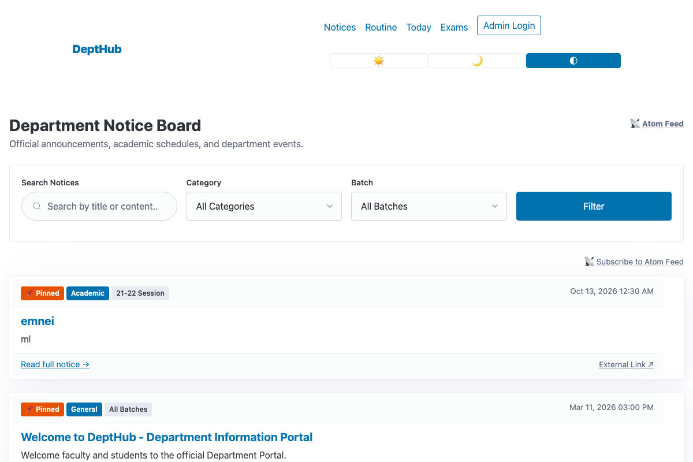
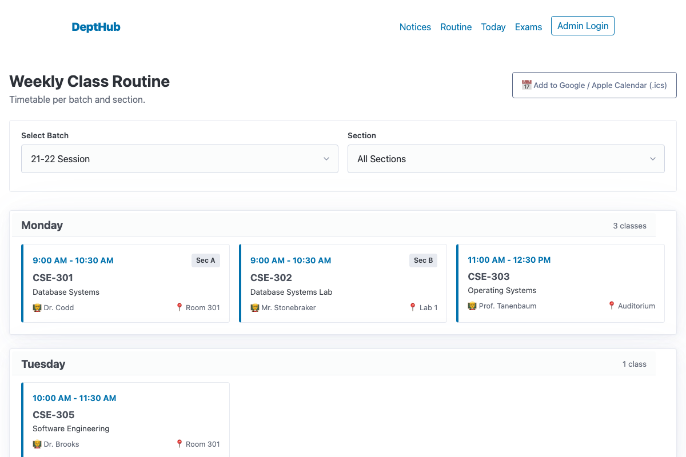
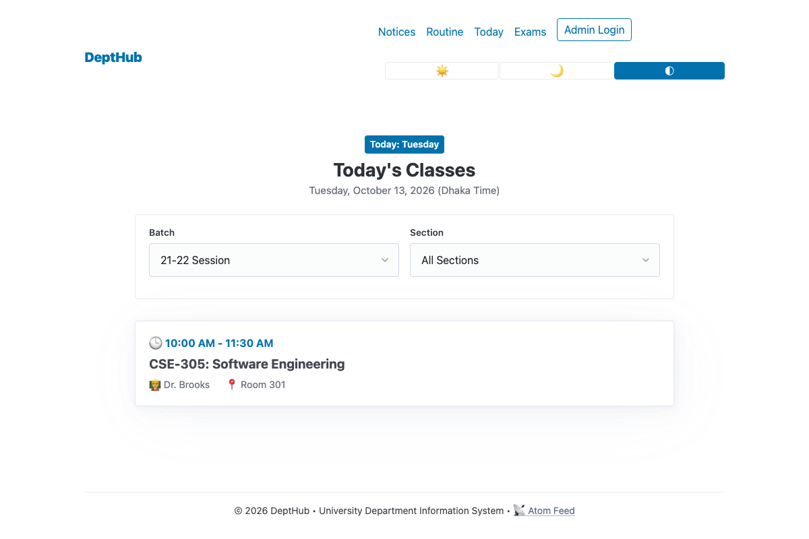
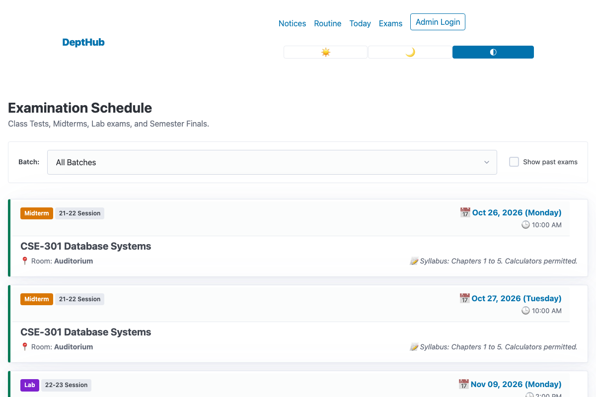
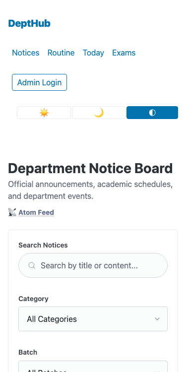
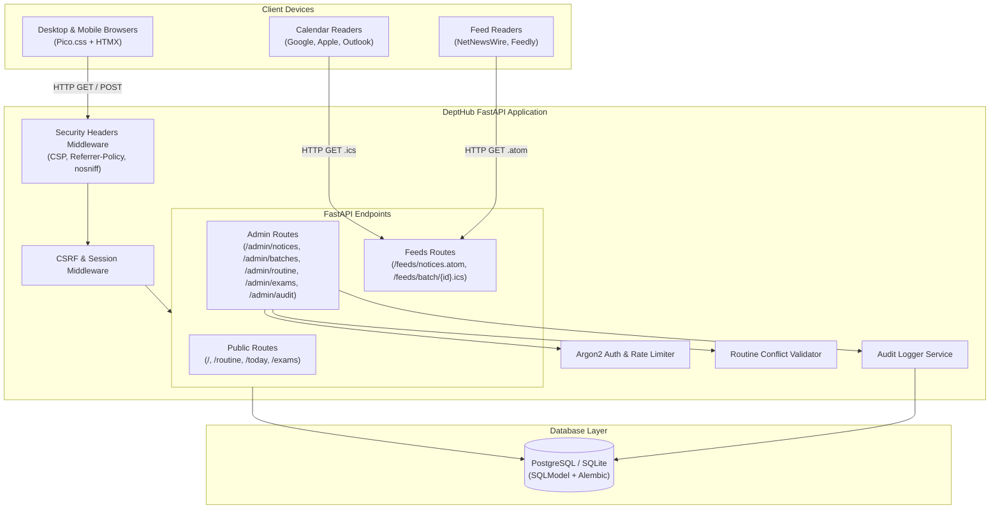

# DeptHub

> Fast, accessible, mobile-first university department portal for notice boards, class routines, and exam schedules with open calendar feeds and zero student accounts.

---

## Run Locally in 2 Commands

```bash
docker compose up --build
```
Then open **[http://localhost:8000](http://localhost:8000)** in your browser.

To seed demo data with batches, timetable slots, notices, and exams:
```bash
docker compose exec app python -m app.seed
```

---

## Screenshots

| Public Notice Board | Weekly Class Routine |
| :---: | :---: |
|  |  |

| Today's Schedule | Examination Timetable |
| :---: | :---: |
|  |  |

| Mobile Viewport (375px iPhone SE) |
| :---: |
|  |

---

## Features

- **Notice Board (`/`)**:
  - Pinned notices anchored to top with stable deterministic ordering.
  - Full-text search across titles and notice bodies.
  - Filter by category (Academic, Exam, Routine, Event, Job, Scholarship, General) and specific student batch.
  - Plain-text bodies with preserved whitespace, auto-escaped HTML, and safe external URL protocol validation.
  - Draft isolation: unpublished drafts are completely hidden from public visitors and feeds.
- **Weekly Class Routine (`/routine`)**:
  - Filterable by student batch and section.
  - Collision-free scheduling: automatic validation prevents teacher and classroom double-booking.
  - Accessible weekly timetable grid with responsive card fallbacks on mobile viewports.
- **Today's Routine (`/today`)**:
  - Automatically identifies the current day's classes evaluated strictly in the department's local timezone (`TIMEZONE`, default `Asia/Dhaka`).
  - Correctly evaluates weekday boundaries across midnight regardless of host server UTC clock.
- **Examination Schedule (`/exams`)**:
  - Categorized by exam type: Final, Midterm, Lab, and Class Test.
  - Chronological sorting with past examinations hidden by default.
  - Interactive "Show past exams" filter toggle.
- **Open Feeds & Calendar Subscriptions (`/feeds`)**:
  - **Atom 1.0 Feed (`/feeds/notices.atom`)**: Latest 30 published announcements formatted with absolute URLs.
  - **iCalendar Feed (`/feeds/batch/{batch_id}.ics`)**: RFC 5545 calendar feed exporting recurring weekly classes (RRULE) and upcoming exams with deterministic, stable UIDs.
- **Administrative Portal (`/admin`)**:
  - Full CRUD management for Batches, Sections, Notices, Routine Slots, and Exams.
  - **Audit Log (`/admin/audit`)**: Immutable paginated audit log tracking actor, action, timestamp, and entity payload for every mutation.
- **Security & Reliability**:
  - Strict Content Security Policy (CSP) with zero inline scripts (`script-src 'self'`).
  - Signed HTTP-only session cookies with `SameSite=Lax` and production `Secure` flags.
  - Database-backed login rate limiter (triggers 429 after 5 failed attempts in 15 minutes).
  - CSRF protection across all state-changing POST requests with HTMX header integration.
  - Complete functionality retained even when JavaScript is disabled.

---

## Tech Stack

- **Backend**: Python 3.12, FastAPI, SQLModel (SQLAlchemy 2.0 core), Pydantic v2, Alembic migrations.
- **Frontend**: Server-rendered Jinja2 templates, vendored Pico.css v2 (semantic CSS), vendored HTMX 1.9.12 (`allowEval: false`), unobtrusive Vanilla JS. Zero client-side build tools or node dependencies.
- **Database**: SQLite (local development), PostgreSQL 16 (Docker & production) via `psycopg` 3.
- **Security & Feeds**: Argon2 (`argon2-cffi`), itsdangerous (signed sessions), icalendar (RFC 5545).
- **Testing & Quality**: pytest, Playwright (end-to-end browser tests), freezegun, ruff.

---

## Architecture



---

## Quick Start (Local Development)

### 1. Prerequisites
- Python 3.12+
- Git

### 2. Setup Virtual Environment
```bash
# Clone the repository
git clone https://github.com/arafatsheikh098/DeptHub.git
cd depthub

# Create and activate virtual environment
python3 -m venv .venv
source .venv/bin/activate

# Install dependencies
pip install --upgrade pip
pip install -r requirements-dev.txt

# Install Playwright browser binaries (for E2E tests)
playwright install chromium
```

### 3. Run Migrations & Seed Demo Data
```bash
# Apply database schema
alembic upgrade head

# Seed demo batches, routine, notices, and exams
python -m app.seed
```

### 4. Start Development Server
```bash
uvicorn app.main:app --reload --host 127.0.0.1 --port 8000
```
Open **[http://127.0.0.1:8000](http://127.0.0.1:8000)**.
- **Admin Credentials**: `admin@dept.local` / `AdminPass123!`

---

## Configuration Reference

DeptHub is configured via environment variables (or `.env` file).

| Variable Name | Purpose | Default | Required? |
| :--- | :--- | :--- | :--- |
| `ENV` | Environment mode (`development`, `test`, `production`). In production, boot fails if `SECRET_KEY` is default. | `development` | No |
| `SECRET_KEY` | Secret key for signing session cookies and CSRF tokens. | `insecure-dev-secret-key-change-in-production` | Yes (in prod) |
| `DATABASE_URL` | SQLAlchemy database connection string (SQLite or PostgreSQL). | `sqlite:///./depthub.db` | No |
| `PUBLIC_BASE_URL` | Canonical public URL used for absolute links in Atom feeds. | `http://localhost:8000` | No |
| `TIMEZONE` | IANA timezone identifier for calculating "Today" timetable and formatting dates. | `Asia/Dhaka` | No |
| `ADMIN_EMAIL` | Optional initial admin email created automatically on first boot. | *None* | No |
| `ADMIN_PASSWORD` | Optional initial admin password created automatically on first boot. | *None* | No |
| `TERM_START` | Academic semester start date for `.ics` recurrence rules (`YYYY-MM-DD`). | `2026-01-01` | No |
| `TERM_END` | Academic semester end date for `.ics` recurrence rules (`YYYY-MM-DD`). | `2026-06-30` | No |
| `FORWARDED_ALLOW_IPS` | Trusted proxy IP addresses for reverse proxy headers (`--forwarded-allow-ips`). | `*` | No |

---

## Running Tests

DeptHub includes a complete automated test suite covering unit logic, integration tests, database migrations, security rules, and Playwright end-to-end browser flows:

```bash
# Run complete test suite (53 passing tests)
pytest -v

# Run lint and formatting checks
ruff check .
ruff format --check .

# Run live endpoint smoke test
./scripts/smoke_test.sh http://127.0.0.1:8000
```

---

## Usage Examples

### 1. Subscribing to Class Timetable via Calendar (.ics)
DeptHub allows students to sync their class schedules directly to their personal devices:
1. Navigate to **[http://localhost:8000/routine](http://localhost:8000/routine)** and select your batch.
2. Click **Add to Google / Apple Calendar (.ics)**.
3. In your calendar application:
   - **Google Calendar**: Click `+` next to *Other calendars* → *From URL* → Paste the `.ics` link.
   - **Apple Calendar**: Click *File* → *New Calendar Subscription* → Paste the `.ics` link.
   - **Microsoft Outlook**: Click *Add calendar* → *Subscribe from web* → Paste the `.ics` link.

### 2. Creating an Administrator via CLI
To provision an admin without web form access:
```bash
python -m app.cli create-admin
# Follow interactive prompts for email and password
```

---

## Project Structure

```
depthub/
├── alembic/                # Database schema migrations
│   └── versions/           # Migration revision files
├── app/
│   ├── models/             # SQLModel database entities
│   │   ├── audit.py        # AuditLog table model
│   │   ├── batch.py        # Batch & Section models
│   │   ├── exam.py         # Exam schedule model
│   │   ├── notice.py       # Notice board model
│   │   ├── routine.py      # Routine slot timetable model
│   │   └── user.py         # Admin user & LoginAttempt models
│   ├── routes/             # FastAPI route handlers
│   │   ├── audit.py        # Administrative audit log viewer
│   │   ├── auth.py         # Login, logout, rate limiter
│   │   ├── batches.py      # Admin batch & section CRUD
│   │   ├── exams.py        # Public & admin exam routes
│   │   ├── feeds.py        # Atom and iCalendar feed endpoints
│   │   ├── notices.py      # Public notice board & admin CRUD
│   │   └── routine.py      # Weekly timetable & Today's schedule
│   ├── static/             # Static assets
│   │   ├── css/            # Pico.css and custom mobile CSS
│   │   └── js/             # Vendored HTMX and unobtrusive app.js
│   ├── templates/          # Jinja2 HTML templates
│   ├── audit.py            # Audit trail recording utility
│   ├── auth.py             # Password hashing & authentication helpers
│   ├── cli.py              # CLI management commands (create-admin)
│   ├── config.py           # Pydantic Settings configuration
│   ├── database.py         # Database engine and session dependency
│   ├── feeds.py            # Atom XML and RFC 5545 ICS feed generators
│   ├── main.py             # FastAPI app factory and lifecycle
│   ├── routine_validation.py # Classroom and teacher conflict rules
│   ├── security.py         # SecurityHeadersMiddleware & CSRF tokens
│   ├── seed.py             # Idempotent database seed script
│   └── utils.py            # Timezone, date formatting, URL safety
├── docs/                   # Playwright screenshots and documentation
├── scripts/
│   └── smoke_test.sh       # Automated smoke test for deployment validation
├── tests/                  # Test suite
│   ├── test_audit.py       # Audit trail unit & integration tests
│   ├── test_auth.py        # Auth & rate-limiting tests
│   ├── test_batches.py     # Batch & section tests
│   ├── test_csrf.py        # Parametrized CSRF protection tests
│   ├── test_e2e.py         # Playwright end-to-end browser tests
│   ├── test_exams.py       # Exam scheduling tests
│   ├── test_feeds.py       # Atom & ICS validation tests
│   ├── test_health.py      # Healthcheck endpoint tests
│   ├── test_migrations.py  # Alembic migration tests
│   ├── test_notices.py     # Notice board & HTML escaping tests
│   ├── test_routine.py     # Timetable overlap & timezone tests
│   ├── test_security_headers.py # CSP & security header tests
│   ├── test_security_startup.py # Production boot security tests
│   └── test_seed.py        # Database seed idempotence tests
├── DEPLOY.md               # Render deployment documentation
├── Dockerfile              # Production container build
├── docker-compose.yml      # Multi-container orchestration (App + Postgres)
├── Makefile                # Development shortcut commands
├── pyproject.toml          # Tooling configuration (Ruff, Pytest)
└── render.yaml             # Render infrastructure blueprint
```

---

## Design Decisions & Limitations

- **D001: SQLite for local dev, PostgreSQL for production**: Eliminates external database setup friction for local developers while ensuring production-grade transactional integrity and concurrency.
- **D002: Redirect out-of-range pagination to last valid page**: Prevents 404 errors for students accessing stale pagination bookmarks when notices are deleted or modified.
- **D003: Block deletion of batches with existing routine slots or exams**: Prevents accidental cascading loss of departmental timetable schedules.
- **D004: Unobtrusive JavaScript & Strict CSP**: Strict CSP prohibits `'unsafe-inline'` script tags. All dynamic interactions use standard HTML forms, HTMX, and data attributes (`data-auto-submit`) in `app.js`.
- **Honest Limitations**:
  - *No student accounts*: DeptHub purposefully avoids student authentication to protect student privacy and minimize operational overhead; all public data is openly accessible.
  - *No file uploads*: Notices support external secure web links (`http`/`https`), avoiding filesystem vulnerabilities.
  - *Single active term*: Calendar recurrence operates across a configured term window (`TERM_START` to `TERM_END`).

---

## Roadmap

Taken from [`BACKLOG.md`](BACKLOG.md):
- **B001**: Official PDF and image circular attachments.
- **B002**: Daily email notification digest for students.
- **B003**: Explicit Light / Dark theme toggle button.
- **B004**: Multi-semester historical routine and exam archive.

---

## Contributing

1. Fork the repository.
2. Create a milestone branch (`git checkout -b feature/my-feature`).
3. Ensure all tests and lint checks pass (`pytest` and `ruff check .`).
4. Commit changes with conventional commit messages.
5. Submit a pull request.

---

## License

This project is licensed under the [MIT License](LICENSE).
